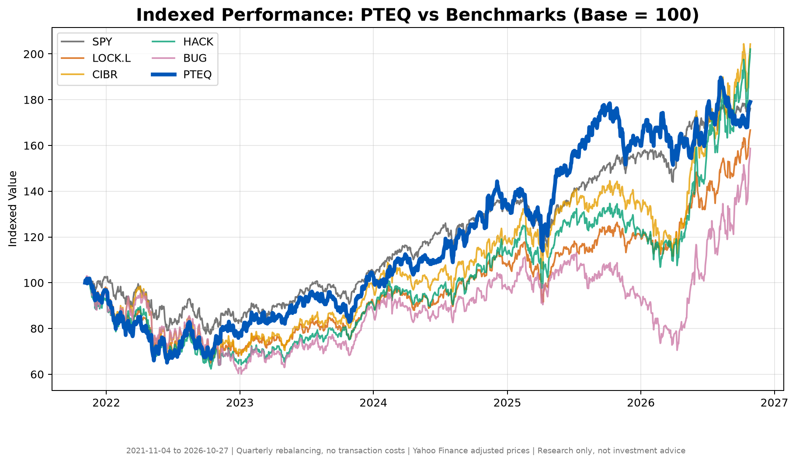
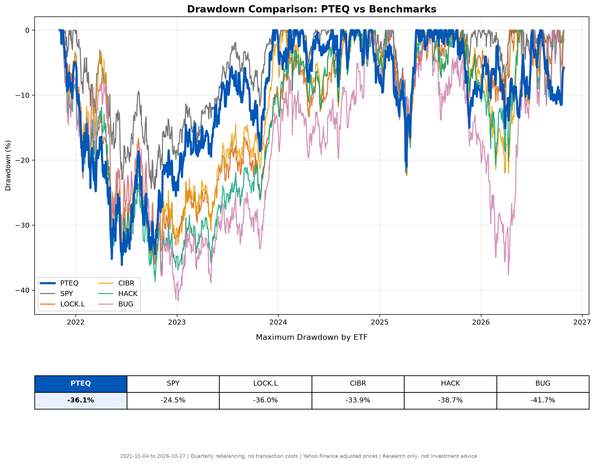
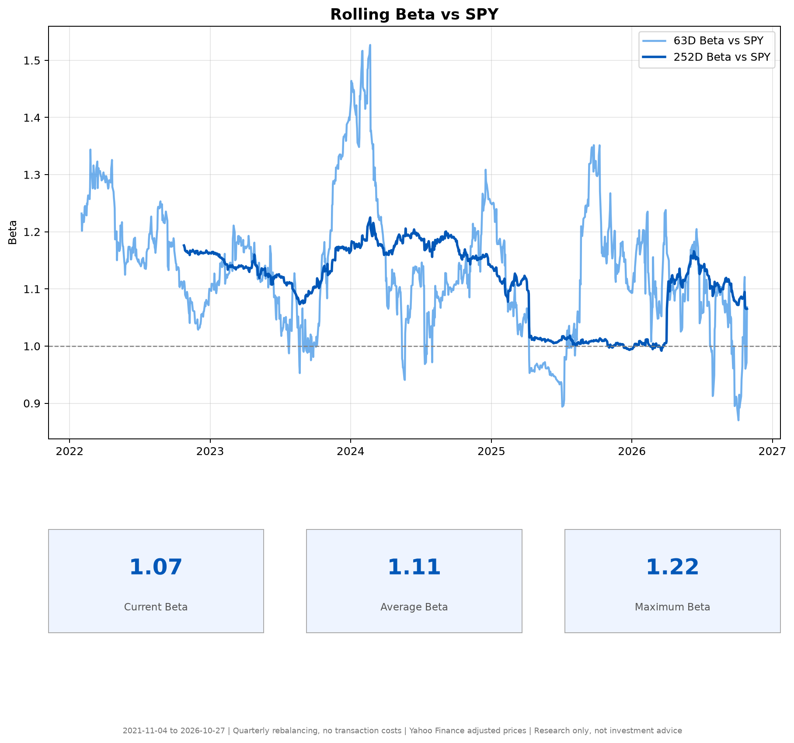
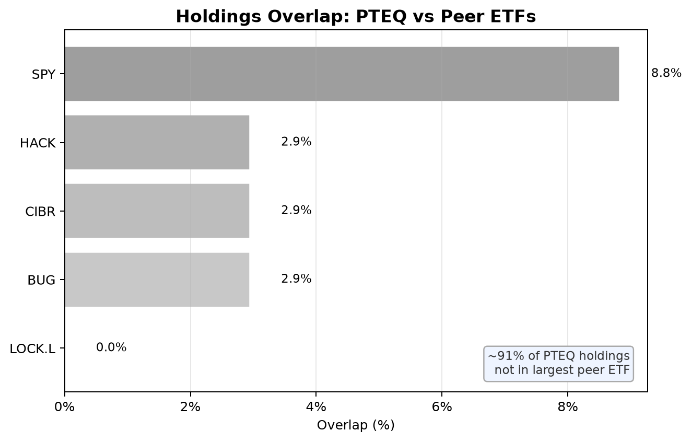

# ETF Dashboard & Quantitative Portfolio Research

A Python research project that evaluates a thematic physical- and digital-security equity portfolio against market and sector ETF benchmarks, alongside a separate financial-news sentiment pipeline.

> **Research prototype, not investment advice.** Historical results are sensitive to data availability, portfolio assumptions, benchmark selection, and survivorship/look-ahead bias. "PTEQ" is the working name of a hypothetical ETF defined by `holdings.csv`. It is not a live fund, and its historical simulation is not an investable track record.

## Overview

Two connected workflows share one set of holdings:

1. **Portfolio analytics** downloads historical prices, builds a quarterly rebalanced portfolio index, compares it with benchmark ETFs, and exports performance and risk charts.
2. **News sentiment** ingests financial news and SEC filing excerpts into SQLite, scores the text with VADER, and shows ticker-level sentiment and prices in a Streamlit dashboard.

## Features

**Portfolio analytics**

- Quarterly rebalanced portfolio index from configured holdings and weights. Late-listed stocks join at the next rebalance instead of truncating the whole history.
- Benchmarks: SPY, LOCK.L, CIBR, HACK, and BUG.
- CAGR, annualized volatility, Sharpe, Sortino, maximum drawdown, Calmar, and alpha/beta versus SPY.
- Rolling beta and correlation, theme and sector concentration, holdings overlap with peer ETFs.
- Exact performance attribution that reconciles to the portfolio's total return.
- Every run records its effective backtest window in `etf_output/run_info.json`.

**News and sentiment**

- Sources: NewsAPI, Alpha Vantage, SEC EDGAR 8-K filings, and Yahoo Finance prices. Sources without credentials are skipped.
- SQLite storage, VADER scoring, and ticker-level aggregation with 7-day momentum.
- Streamlit dashboard with sentiment summaries, recent articles, and the portfolio charts.

## Repository structure

```text
ETF-Dashboard/
├── analytics.py            # Portfolio construction and metrics (pure functions, unit-tested)
├── etf_charts.py           # Data download, chart export, CSV summaries
├── dashboard.py            # Streamlit dashboard
├── master_fetcher.py       # News, filing and price ingestion into SQLite
├── sentiment_scorer.py     # VADER scoring and summary
├── sentiment_utils.py      # Shared DB access, labels and summary query
├── etf_holdings.json       # ETF universe, categories, news keywords and SEC CIKs
├── holdings.csv            # Target portfolio weights
├── theme_map.csv           # Theme, bucket and sector for each holding
├── peer_holdings.csv       # Peer ETF constituents for the overlap chart
├── etf_output/             # Generated charts, CSV summaries and run_info.json
├── docs/methodology.md     # Methodology and limitations
├── tests/                  # pytest suite
├── .env.example            # Environment variable template
├── requirements.txt        # Runtime dependencies
└── requirements-dev.txt    # Adds pytest and ruff
```

## Setup

Requires Python 3.11 or newer. From the repository root:

```bash
python -m venv .venv
source .venv/bin/activate        # macOS/Linux
# .venv\Scripts\activate         # Windows PowerShell
python -m pip install --upgrade pip
pip install -r requirements.txt
cp .env.example .env
```

Add API keys to `.env` to enable those sources, and never commit `.env`. The portfolio analysis uses Yahoo Finance through `yfinance` and needs no keys.

For SEC EDGAR requests, set `SEC_USER_AGENT` to a descriptive application name and a real contact email, as SEC guidance requires. Filings are skipped until it is set.

## Usage

### Portfolio analysis

```bash
python etf_charts.py
```

Charts and CSV summaries are written to `etf_output/`. Prices are downloaded when the script runs, so results can change as data providers revise their history.

### News sentiment dashboard

```bash
python master_fetcher.py      # collect news, filings and prices into etf_news.db
python sentiment_scorer.py    # score new articles
streamlit run dashboard.py
```

The news tabs stay empty until the database has scored articles. The database is generated locally and excluded from version control.

### Tests

```bash
pip install -r requirements-dev.txt
pytest
ruff check .
```

## Configuration

| What | Where |
| --- | --- |
| Target weights | `holdings.csv` |
| Themes, buckets, sectors | `theme_map.csv` |
| Benchmarks, start date, rolling windows | constants at the top of `etf_charts.py` |
| Rebalance frequency, risk-free rate, start-coverage rule | constants at the top of `analytics.py` |
| News keywords and SEC CIKs | `etf_holdings.json` (`holdings`) |
| Dashboard categories | `etf_holdings.json` (`etfs`) |

## Example outputs

Committed example outputs are historical analysis artifacts, not live results or a promise of future performance. The backtest window for any run is printed in each chart's footnote and stored in `etf_output/run_info.json`.

### Indexed performance



### Drawdown comparison



### Rolling beta



### Holdings overlap



## Methodology and limitations

Read [`docs/methodology.md`](docs/methodology.md) before interpreting any chart or metric. In particular, the simulation applies the *current* holdings and weights to past prices rather than reconstructing point-in-time constituents, which introduces survivorship and look-ahead bias. Sentiment labels are heuristic descriptions of VADER scores and have not been shown to predict returns.

## Tech stack

Python · pandas · NumPy · Matplotlib · Plotly · Streamlit · SQLite · yfinance · VADER Sentiment · NewsAPI · Alpha Vantage · SEC EDGAR · pytest · Ruff

## Disclaimer

This project is not investment advice, a recommendation to buy or sell securities, or a representation of a live ETF. Data providers may impose access limits, revise historical data, or return incomplete records. Validate assumptions and calculations independently before relying on any output.
